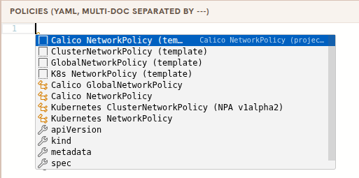

# Let's get to know Peacha!

Peacha lets you write and test Kubernetes and Calico network policies in a safe,
controlled environment - no real cluster required. Edit policy on the right and
watch its exact impact on the left, instantly.

The left pane has **three tabs** along the top - this is how you move around:

- **Playground** - this page. A free-form sandbox: paste or write any policy in
  the editor and explore its impact. Stay here to experiment, and use the share button at the top to share your policies with your friends!
- **Tutorials** - a guided, read-along track that teaches network policy from
  scratch, one lesson at a time (see below).
- **Exams** - graded challenges that check your work, and grants you a Credly badge.

>
> **Tip:** Use `ctrl + space` in the editor to activate completion suggestions. 
> 
>

After adding a policy to the editor, check out the **Matrix** and **Graph**
views. Both visualize the impact of your policy using the Calico Unified Platform
policy engine and help you understand each part of your policy. In the Graph,
each pod also shows a **port-reachability chip** (`⊟ open/total`, green/red/amber)
- hover it to see, port by port, what can reach that pod and what is blocked.

You can also use the `eBPF`, `iptables`, and `nftables` tabs to see how each
policy is actually programmed into your cluster across Calico's different
dataplanes.

## The policy wizard

Not sure of the YAML? The Graph view has a **＋ policy wizard** button. Click it
and build a policy step by step - no typing required:

- **Pick a kind** - grouped into Kubernetes, Calico, and Calico advanced
  resources (staged policies, tiers, host endpoints).
- **Fill the form** - fields for that kind (and only that kind) appear; nested
  rules, peers, and ports reveal themselves as you add them, and comboboxes
  suggest live values from your topology.
- **Add it** - the wizard serializes your choices to YAML and appends them to
  the editor, where you can keep editing by hand.

The form is driven by the same schema that validates the editor, so anything you
can build in the wizard is valid the moment you add it.

## The tutorials track

New to Kubernetes networking and security? Switch to the **tutorials** tab. It's
a read-along course that walks all four policy types end to end - **Kubernetes
NetworkPolicy**, **Calico NetworkPolicy**, **ClusterNetworkPolicy** (the Network
Policy API), and **GlobalNetworkPolicy** - building from your first policy up to a
full layered, default-deny posture.

Each lesson is interactive:

- **Runnable examples** - YAML blocks carry a **▶** button that loads the snippet
  straight into the editor (and a copy button), so you read and run in one place.
- **Knowledge checks** - short in-page quizzes let you test your understanding as
  you go; they're graded right in the browser.

## The exams track

When you want to prove it, switch to the **exams** tab. Each exam gives you a
scenario and asks you to write policy that achieves a target connectivity outcome.
Press **Check my answer** and the server grades your submission against an expected
connectivity matrix (and policy constraints) - the grading runs server-side, so it's
authoritative.

Exams may ask you to **sign in** (Slack, Google, or GitHub) so your progress is
tracked. Passed exams are marked with a ✓ and you advance to the next unsolved one.

## The topology editor

Peacha keeps **workloads** and **policy** in two separate editors:

- **Policy editor** (right) - the policies you're writing and testing.
- **Topology (YAML)** pane (left, stacked under the docs) - everything policy
  runs *against*: namespaces, pods, probes, and resources. This is where you
  edit the building blocks described below.

Both are plain YAML. Edits to the topology parse straight back into the model; a
parse error is surfaced and your last good state is kept, so a half-typed
document never wipes your work. The doc opens with a commented **field-reference
cheat-sheet** - uncomment and edit it, or write your own.

Toolbar controls:

- **load topology** - replace the workloads layer with your own file.
- **reset workloads** - restore the embedded default topology.
- **system baseline** - read-only. The system pods (`kube-system`,
  `calico-system`, `tigera-operator`, cluster nodes, host endpoints) are
  injected per-provider and merged in at evaluate-time; this pane shows what
  your workloads sit on top of.

## Namespaces & pods

- **Namespaces** group pods and carry labels (`kubernetes.io/metadata.name` is
  auto-set to the namespace name). Rules select pods *across* namespaces with a
  `namespaceSelector`.
- **Pods** are the endpoints policy is applied to. Each gets an
  auto-assigned IP in `10.0.0.0/24` and an `app=<name>` label by default.
- **System namespaces** (`kube-system`, `calico-system`, `tigera-operator`,
  `local-path-storage`) load from the embedded baseline, are included in every
  evaluation, and show read-only.

### Advanced pod fields

| Field | Purpose |
| --- | --- |
| `serviceAccount` | Projects `pcsa.*` labels onto the pod (define the SA under **resources**). |
| `node` | Pins the pod to a node - host-endpoint overlays then apply. |
| named ports | `name=port/proto`, referenced by name from rule ports. |

## Tiers

Policies live in **tiers**, evaluated top → bottom. **Lower `order` = higher
precedence** (evaluated first).

- Three **reserved** tiers always exist and can't be edited.
- A tier's `defaultAction` (`Deny` / `Pass`) decides what happens when no rule
  in the tier matches.
- Reference a custom tier from a Calico policy's `spec.tier`.

> A `Pass` default hands evaluation to the next tier; a `Deny` default stops
> here and drops the packet.

## Probes

A probe is a synthetic connection the engine traces against your policy:

- **Protocol** - `tcp`/`udp`/`sctp`/`udplite` carry a port; `icmp`/`icmpv6`
  carry a type/code instead.
- **srcPort**, **http method**, **http path** refine L7 matching (HTTP method
  and path apply to ingress rules only).

## Resources

Optional objects rule selectors resolve against:

- **External endpoints** - off-cluster destinations, matched by IP against
  egress rules; shown as `[EXT]` rows.
- **Host endpoints** - node interfaces treated as policy-bearing endpoints.
- **Network sets** / **global network sets** - labelled CIDR bags.
- **Service accounts** - projected as `pcsa.*` labels onto matching pods.
- **Services** - resolve `source`/`destination.services`; endpoint slices
  derive from the selector.

Resources can also be **pasted as YAML** into the policy editor - those appear
here read-only, badged *from YAML*.

## Evaluation flags

- **evaluate staged policies as enforced** - treat `staged*` policies as if
  they were live.
- **strict lint** - promote lint warnings to errors.
- **DNS stub** - `host=ip,ip` per line, resolving `destination.domains` rules.

---

Ready? Switch to the **tutorials** tab and start with *Your first policy:
Kubernetes NetworkPolicy* - the policy API most clusters already run - or jump
straight to the **exams** tab if you'd rather be tested.
